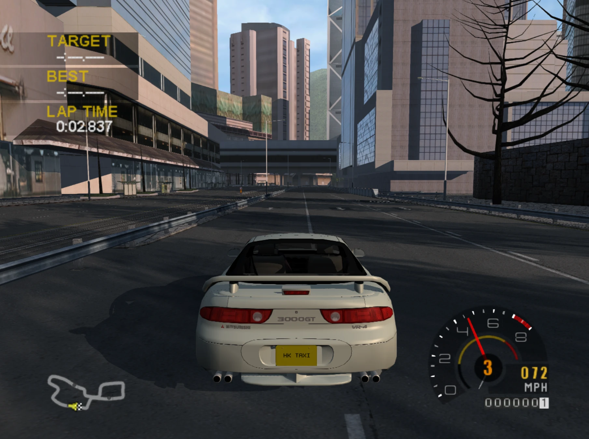

# Project Gotham Racing 2 — Static Recompilation



A native Windows (x64) port of the original-Xbox *Project Gotham Racing 2* (Bizarre Creations / Microsoft, 2003).
Every x86 function in the retail `default.xbe` is translated to C, compiled with MSVC and linked against a
replacement Xbox kernel, audio, input and GPU runtime; the NV2A command stream is rendered with Direct3D 11.
No emulator CPU core, interpreter or JIT.

Built on [xboxrecomp](https://github.com/sp00nznet/xboxrecomp) v0.15.0 (MIT, git submodule) with the local
changes in `patches/xboxrecomp.patch`, scaffolded from rsc2recomp and
[mm3recomp](https://github.com/xbox-games-recomp/mm3recomp).

> **No game content is in this repository.** You need your own copy of the game. Everything derived from it
> (generated C, builds, logs, dumps) is git-ignored.

**Status:** intro movies, menus, car selection and full street races with their replays, with audio and a
gamepad or keyboard. Races run at the console's 30 fps; 60 fps is an option. The player's car renders too dark
(see [Open issues](#open-issues)).

## Quick start

1. Download `pgr2recomp-<version>-windows.zip` from this repository's releases and unzip it to a short path
   such as `C:\Games`.
2. Run `pgr2_launcher.exe`, choose your disc image or extracted disc, press **Run setup**, then **Play**.

Setup installs the build tools with winget if needed (Git, Python 3.12 with `capstone`, CMake, Visual Studio
2022 Community with the C++ workload), fetches the toolkit, extracts the disc into `game_files\`, then
recompiles and builds the game (about 20 minutes). The launcher's
[player guide](https://github.com/xbox-games-recomp/xbox-recomp-launcher#readme) covers each step and
troubleshooting.

## Game version

`config/seed_functions.json`, `src/recomp_manual.c` and `scripts/patch_gen.py` name guest addresses, so only
this executable works:

| | |
|---|---|
| Title ID | `0x4D53004B` (XBE 2003-10-14, region NA/JP, XDK 5659) |
| `default.xbe` SHA-1 | `702b79fd3bc844a413cbc26404718b1bf7e44e87` (2,707,456 bytes) |

The disc is a plain XDVDFS partition. Extract all of it into `game_files\` (or link an extracted copy there):

```bat
python -I scripts\xiso_extract.py "Project Gotham Racing 2.iso" game_files
```

`extract-xiso -x` works too.

## Building from source

Needs Windows 10/11, Visual Studio 2022 (C++ workload), CMake 3.20+ (on `PATH` or in its default folder),
Git, Python 3.10+ with `capstone`, and a Direct3D 11 GPU.

```bat
git submodule update --init
python -m pip install capstone
powershell -ExecutionPolicy Bypass -File scripts\regen.ps1
cmake --build build --config Release
```

1. `regen.ps1` (15–20 min, prints `BUILD_EXIT=0`) applies `patches\xboxrecomp.patch` to the submodule
   (`scripts\apply_patches.ps1`, a no-op once applied), runs the toolkit's pipeline on
   `game_files\default.xbe` into `src\recomp\gen\`, applies `scripts\patch_gen.py`, then configures and
   builds `build\`. `$env:PYTHON` and `$env:CMAKE` override the tools it finds.
2. `cmake --build` is the code-only rebuild (~1 min) after editing `src\`. On a fresh clone that never ran
   `regen.ps1`, run `scripts\apply_patches.ps1` first.

The output is `build\Release\pgr2_recomp.exe`; `pgr2_launcher.exe` is built next to it and copied to the
repository root.

## Running

`pgr2_launcher.exe` sets the options below as environment variables, starts the game and logs to `run.log`;
`--play` skips the window. Other variables go on its **Launcher** page. Starting the exe yourself, set the
`[env]` variables from `launcher.ini` first: without them the game does not run.

| Launcher setting | Variable | Default | Effect |
|---|---|---|---|
| Internal resolution | `RECOMP_D3D11_RES` | `2` | 1–6 × 640x480; above the window size it is supersampling. The window keeps 4:3 |
| FXAA edge smoothing | `RECOMP_D3D11_FXAA` | off | FXAA at present |
| Vertical sync | `RECOMP_D3D11_VSYNC` | on | |
| Race frame rate | `RECOMP_PRESENT_INTERVAL` | `2` (30 fps) | `1` = 60 fps through the game's own PresentInterval; the race slows down whenever the PC drops a frame |
| Keyboard controls | `RECOMP_KEYBOARD` | on | Keyboard as a pad |
| Rumble | `RECOMP_RUMBLE` | on | |
| Hitch log | `RECOMP_D3D11_HITCH` | `60` | Log every frame slower than this many ms |
| Hang watchdog | `RECOMP_WATCHDOG_SECS` | `900` | Dump the game's state to the log after this long without progress |
| Flight recorder | `RECOMP_D3D11_RING` | `240` | F12 saves the last N frames to `flicker\` |

**Controls:** XInput pads map 1:1 to the Xbox pad. Keyboard: arrows = D-pad, Enter = Start, Z/X/C/V = A/B/X/Y,
WASD = left stick, 1/3 = triggers. Press Start (not A) at the title screen; A starts the attract demo.

Saves go to `%LOCALAPPDATA%\xboxrecomp\UDATA\4d53004b` (the launcher's **Saves** page); `RECOMP_SAVE_ROOT`
moves the whole save tree for test runs.

## How it works

```
default.xbe ─► disasm ─► func_id ─► abi_analysis ─► recomp ─► patch_gen.py ─► MSVC ─► pgr2_recomp.exe
               (capstone + seeds in config/seed_functions.json)      (x86 → C)         + xboxrecomp runtime
```

- **xboxrecomp** supplies the Xbox kernel, an emulated MCPX APU (→ XAudio2), XInput and the NV2A pushbuffer
  executor. **`patches/xboxrecomp.patch`** carries this port's toolkit fixes (utility drive, 8-bit `mul`/`div`
  lifting, safe guest-thread suspend, APU traps, ...). Regenerate it with
  `git -C xboxrecomp diff > patches\xboxrecomp.patch` from Bash (it must stay LF).
- **`config/seed_functions.json`** adds functions reached only through immediates and pointer tables.
- **`src/recomp_manual.c`** replaces guest functions that depend on hardware or the XDK (GPU fence wait,
  pads, the 60 fps PresentInterval hook, DirectSound guards).
- **`scripts/patch_gen.py`** applies anchored fixes to the generated C (renames functions that
  `recomp_manual.c` wraps).
- **`src/d3d11_backend.c`** translates NV2A vertex programs to HLSL and runs the register combiners in one
  data-driven pixel shader, with a flip-model swap chain.

`NOTES.md` is the engineering log (every bug, cause and fix). `scripts\dev\` (`to_carselect.ps1`, `live.ps1`,
...) drives test runs; `xdis.py`, `xrefs.py`, `xfind.py`, `xmatch.py` and `xemu_shader_cache.py` are analysis
helpers.

## Open issues

1. The player's car renders almost black in races (not yet compared with xemu).
2. DirectSound's release wait can spin forever (seen once); `RECOMP_DS_VOICEWAIT` ends it after 2 s and logs
   `[DSWAIT]`.
3. At 60 fps every dropped frame slows the race, so 30 stays the default. A 60 Hz monitor is untested at 60.
4. Unseeded CRT x87 entries may still show up as `[ICALL] Failed 0x001B5xxx` in the log.
5. A full player-driven race, other cities and modes, time-attack ghosts and split screen are untested;
   Xbox Live is not available.

## Legal

An independent, non-commercial preservation project, not affiliated with Microsoft, Xbox Game Studios,
Bizarre Creations or any car manufacturer. *Project Gotham Racing* is the property of its owners. Do not open
issues or pull requests containing game files or generated code. The toolkit in `xboxrecomp/` is MIT-licensed;
the patch modifies it under that license.
